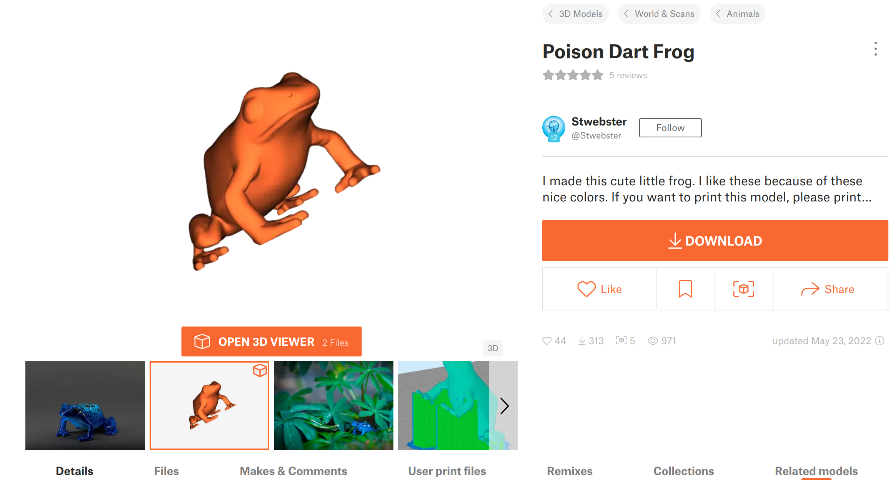
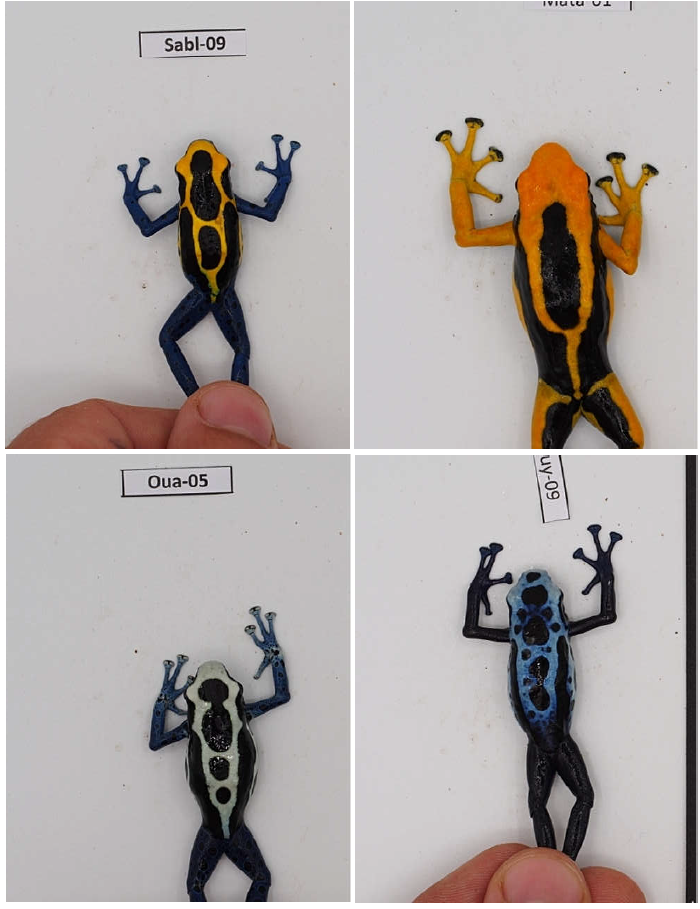
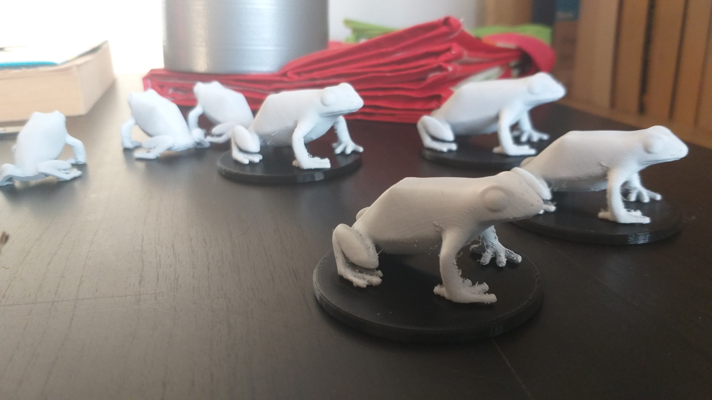
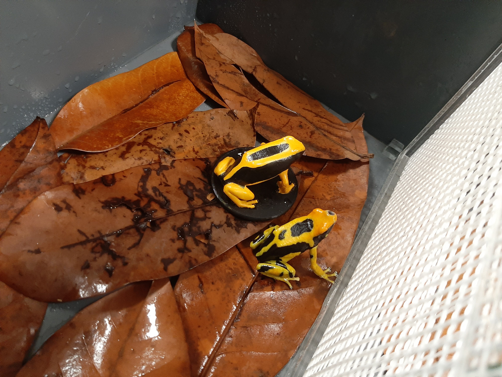
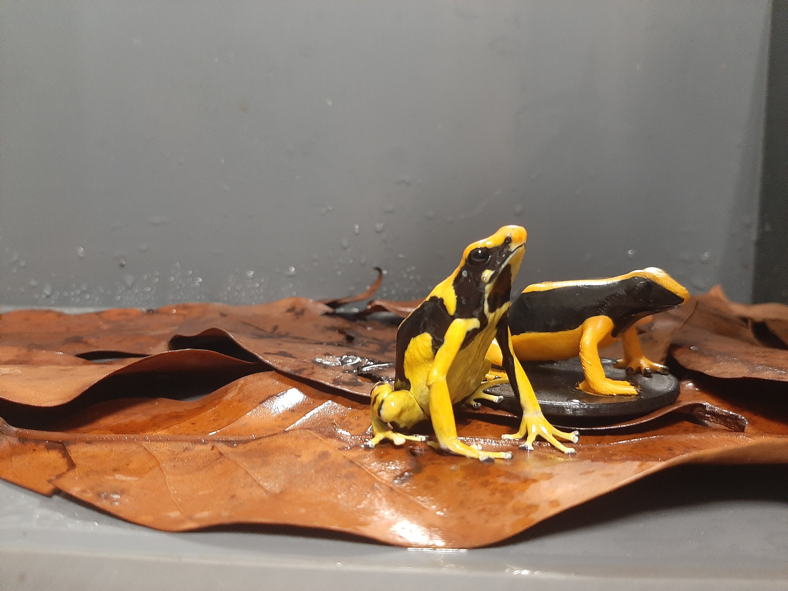

Recentemente, a minha esposa desenhou uma experiência comportamental onde era preciso um sapo falso (dos coloridos "poison dart", da família Dendrobatidae).
Isto é, era preciso que o corpo de um sapo estivesse presente enquanto outro estímulos são apresentados ao indivíduo alvo.
Tentamos procurar por modelos comerciais online mas não fomos bem sucedidos.
Tinhamos comprado recentemente uma impressora 3D (uma Ender 3), por isso decidimos tentar a velha abordagem do "desenrascanço" (DIY).

Procurámos em todos os tipos de websites de modelos 3D por modelos que se aproximassem de um sapo "poison dart".
Na altura, também não fomos bem sucedidos na procura de modelos super exatos.
Acabámos por escolher [este modelo](https://www.printables.com/model/211953-poison-dart-frog).
O volume do corpo parecia demasiado grande, e as pernas de trás pareceram demasiado pequenas, mas continuámos com este de qualquer forma.
Na altura em que escrevo isto (um ano e meio depois da experiência em si), encontrei um modelos mais exatos como [este em myminifactory.com](https://www.myminifactory.com/object/3d-print-poison-dart-frog-222271) e [este em sketchfab.com](https://sketchfab.com/3d-models/strawberry-poison-dart-frog-e51fa3941ceb42cc985524c138e91f8b).

Depois de encontrado um modelo suficientemente bom, começámos a olhar para as populações de sapos que seriam usados na experiência.
Apesar do uso de uma única espécie na experiência ([*Dendrobates tinctorius*](https://en.wikipedia.org/wiki/Dyeing_poison_dart_frog)), esta tem uma variabilidade incrivel de tamanhos e cores entre locais.
Uma vez que iam ser usadas quatro populações, tivemos de imprimir estes modelos com quatro escalas diferentes e quatro "morpfs" de côr correspondentes.
Para ter modelos com o tamanho mais ou menos correto, medimos o comprimento snout-vent (basicamente, do nariz até ao rabo) de cada "morf" e tentamos escalar os modelos com o programa de "slice" de modo a que correspondesse às medidas dos sapos reais.

Equacionar as cores envolveu um bocado de mais trabalho.
Quando os sapos usados na experiência foram apanhados da Natureza, foram fotografados de cima (numa das figuras acima) o que nos deixou ver o seu padrão dorsal e cores correspondentes.
Infelizmente, não tinhamos uma foto ventral por isso tive de especular.
Escolhemos um único indivíduo macho de cada "morf" para ser copiado para os modelos.
Depois de acabados de imprimir, e confirmamos que nenhum dos modelos tinha artefactos esquisitos de impressão, comecei por cobrir o modelo todo com um spray primário branco.
Em cima desta camada primária e com a ajuda das fotos dorsais, desenhei os padrões de cada "morf" a lápis e pintei as cores correspondentes o mais próximo do original possível.
Para isto, usei tintas acrilicas compradas na loja mais próxima.
Finalmente, quando contente com os resultados, cobri o modelo com várias camadas de verniz brilhante, para tornar a tinta mais resistente a arranhões e humidade.
O vendedor na loja disse-nos que o verniz que usámos não tinha odores, mas não podemos mesmo confirmar ou discordar se é o mesmo caso para os sapos.

Qual foi o resultado final?
Parece ter funcionado.
Os resultados da experiência em si não foram ainda publicados, mas os indivíduos da experiência parecem ter tentado interagido com os nossos modelos.
E no fim era esse o objetivo!

Podemos melhorar este processo para o futuro?
Acho que é um tópico de discussão interessante.
Com a facilidade de obter e usar impressoras 3D a aumentar, ciência e mais especificamente ciência do comportamento poderá beneficiar de um repositório de modelos 3D exatos de espécies.
Poderá algo assim existir no futuro?
Quão difícil é fazer um model exato de um organismo vivo?
